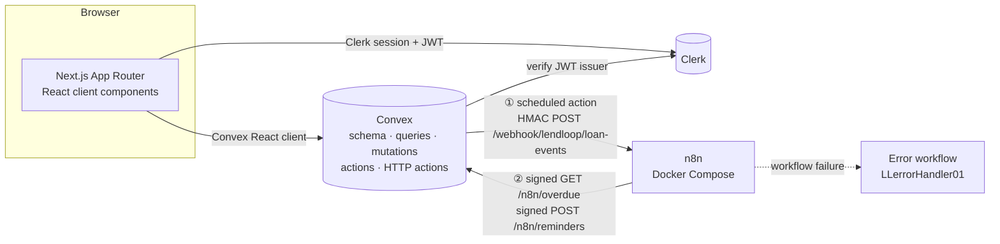
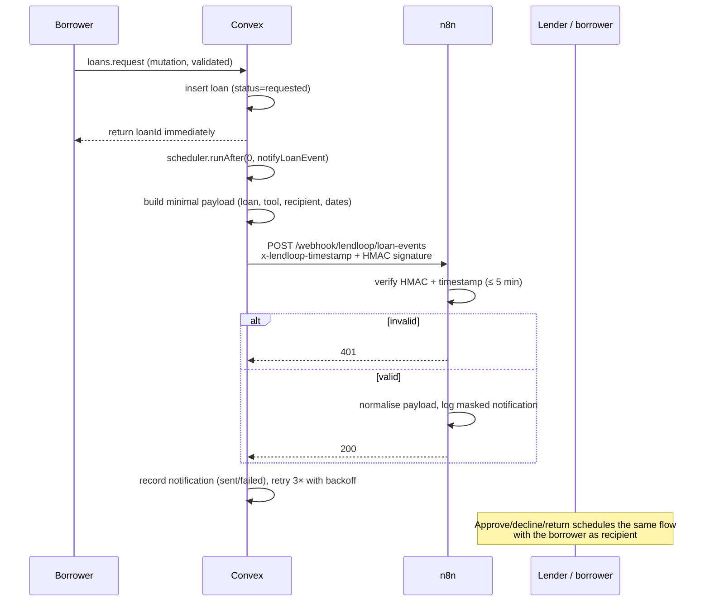
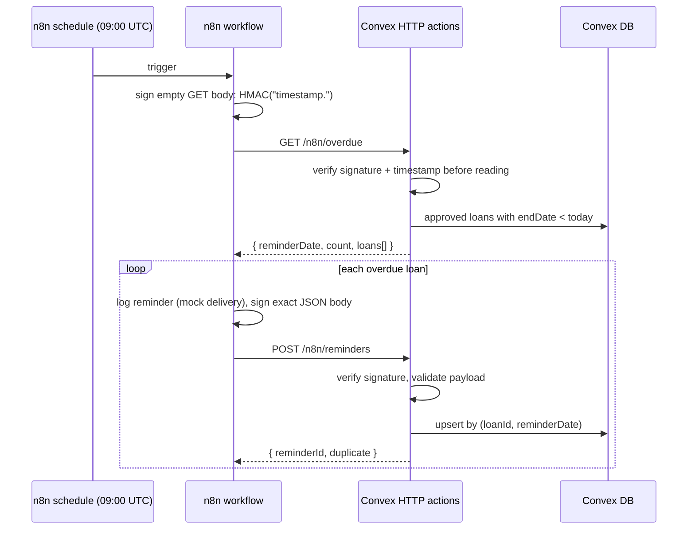

# LendLoop

**Borrow what you need. Lend what you don't.**

A neighborhood tool-lending board built with Next.js (App Router), TypeScript, Clerk,
Convex, Tailwind CSS and self-hosted n8n. Neighbors list tools, request a date range, and
the lender approves or declines. n8n handles request notifications and daily overdue
reminders, with HMAC-signed traffic in both directions.

> This repository was built as a take-home assignment. The **Verified vs. unverified**
> section at the bottom is deliberately explicit about what was and was not exercised in
> the development environment.

---

## What you can do

- **Signed out** — see the LendLoop name, tagline, and a read-only shelf of tools showing
  **only name and category**. No owner name, email, id, description or availability is
  sent to the browser.
- **Signed in** — browse tools with availability and a Trusted Lender badge, filter by
  category, list a tool, edit or remove your own listings, request a date range, and see
  your own requests.
- **As a lender** — review incoming requests, approve or decline, and mark a loan returned.
- **As an admin** — view every loan, remove any listing (pending requests are declined),
  and grant or revoke the Trusted Lender badge. Admins cannot approve or decline loans they
  are not a party to.
- **Automation** — request/status notifications are sent to n8n by a scheduled Convex
  action; a daily n8n workflow fetches overdue loans and writes reminder records back.
  Recent notification/reminder activity is shown on loan cards.

---

## Stack

| Layer | Choice |
| --- | --- |
| App | Next.js 16 App Router, React 19, TypeScript strict |
| Styling | Tailwind CSS 4 |
| Auth | Clerk 7 (JWT template for Convex) |
| Data + backend | Convex (queries, mutations, actions, HTTP actions) |
| Automation | n8n 2.x, self-hosted with Docker Compose |
| Tests | Vitest 5 + `convex-test` + edge-runtime |
| Package manager | pnpm, installed through `safe-install` |

---

## Quick start

### 0. Prerequisites

- Node.js **20.9+**
- pnpm (the repo pins `pnpm@11.17.0`; `corepack enable` is the easiest route)
- Docker + Docker Compose
- A Clerk account and a Convex account (a local Convex deployment also works)

### 1. Install dependencies

```bash
safe-install install --frozen-lockfile
```

If `safe-install` is not installed, follow your organization's tooling instructions; the
equivalent plain command is `pnpm install --frozen-lockfile`. The lockfile is committed.

### 2. Create the Clerk application

1. Create a new application in the [Clerk dashboard](https://dashboard.clerk.com).
2. Go to **Configure → JWT Templates → New template → Convex**. Keep the name `convex`
   and the audience `convex` (the template preset already sets these).
3. Copy the **Issuer** URL, for example
   `https://your-app.clerk.accounts.dev`.
4. Copy the **Publishable key** and **Secret key** from **Configure → API keys**.

Copy the Next.js environment file and fill in the Clerk keys:

```bash
cp .env.example .env.local
```

```dotenv
NEXT_PUBLIC_CLERK_PUBLISHABLE_KEY=pk_test_...
CLERK_SECRET_KEY=sk_test_...
```

`npx convex dev` will add `NEXT_PUBLIC_CONVEX_URL` and `NEXT_PUBLIC_CONVEX_SITE_URL` to
`.env.local` automatically. Do not edit those by hand unless you are pointing at an
existing deployment.

### 3. Start Convex and configure its environment

In a second terminal:

```bash
npx convex dev
```

For a brand-new project this creates a deployment and pushes the schema/functions. Then set
the server-side variables (the values live only on the Convex deployment, never in the
repo):

```bash
npx convex env set CLERK_JWT_ISSUER_DOMAIN https://your-app.clerk.accounts.dev
npx convex env set ADMIN_EMAILS you@example.com
npx convex env set N8N_HMAC_SECRET "$(openssl rand -hex 32)"
npx convex env set N8N_REQUEST_WEBHOOK_URL http://localhost:5678/webhook/lendloop/loan-events
```

Notes:

- `ADMIN_EMAILS` is a comma-separated allow-list. A user whose verified Clerk email is on
  the list is promoted to `admin` the next time their profile is synced. Removing an email
  does **not** demote an existing admin.
- Keep the `N8N_HMAC_SECRET` value for the n8n step; both sides must use the same secret.
- `N8N_REQUEST_WEBHOOK_URL` must be the **production** webhook path (`/webhook/...`), not
  the editor's `/webhook-test/...` path. It must be reachable from the Convex deployment.
  For Convex Cloud, use a public HTTPS URL or tunnel to your local n8n.
- If you use a local Convex deployment, the HTTP actions are served on port **3211**
  (`NEXT_PUBLIC_CONVEX_SITE_URL`). The Convex API is on 3210.

### 4. Start n8n with Docker

```bash
cp n8n/.env.example n8n/.env
```

Generate both secrets and put them in `n8n/.env`:

```bash
openssl rand -hex 32   # N8N_ENCRYPTION_KEY
openssl rand -hex 32   # LENDLOOP_HMAC_SECRET — same value as Convex N8N_HMAC_SECRET
```

`LENDLOOP_HMAC_SECRET` **must** equal the Convex `N8N_HMAC_SECRET` from step 3.
`LENDLOOP_CONVEX_URL` is the Convex **HTTP actions** origin, not the API origin:

- Local Convex from inside Docker: `http://host.docker.internal:3211`
- Convex Cloud: `https://your-deployment.convex.site`

Then:

```bash
docker compose up -d
docker compose logs -f n8n
```

Open <http://localhost:5678>. The named volume `n8n_data` persists the database and the
encryption key keeps stored credentials decryptable across restarts.

### 5. Import and publish the workflows

The repository ships three workflows:

| File | ID | Purpose |
| --- | --- | --- |
| `n8n/workflows/loan-events.json` | `LLloanEvents0001` | Signed request/status notification webhook |
| `n8n/workflows/overdue-reminders.json` | `LLoverdueDaily01` | Daily 09:00 UTC overdue reminder job |
| `n8n/workflows/error-handler.json` | `LLerrorHandler01` | Error Trigger logging wired to both workflows |

Import with the CLI (SQLite preserves the IDs in the filenames, so the error-workflow
reference stays intact):

```bash
docker compose exec n8n n8n import:workflow --input=/workflows/error-handler.json
docker compose exec n8n n8n import:workflow --input=/workflows/loan-events.json
docker compose exec n8n n8n import:workflow --input=/workflows/overdue-reminders.json
```

Imports are deactivated by default. Publish each workflow (n8n 2.x uses
publish/unpublish instead of the old active toggle):

```bash
docker compose exec n8n n8n publish:workflow --id=LLerrorHandler01
docker compose exec n8n n8n publish:workflow --id=LLloanEvents0001
docker compose exec n8n n8n publish:workflow --id=LLoverdueDaily01
docker compose restart n8n
```

If you import through the UI instead, n8n assigns new IDs. In that case open each workflow's
**Settings → Error Workflow** and select **LendLoop — Error handler** manually, then publish
all three workflows in the UI.

The daily workflow is scheduled at `0 9 * * *` and the container runs in UTC
(`GENERIC_TIMEZONE=UTC`, `TZ=UTC`). Change the schedule and timezone together if you want
local-time reminders.

### 6. Seed demo data

The seed script is an internal Convex mutation, so it is run from the CLI rather than
exposed to the browser.

**Recommended:** sign in to the app once (this creates your Convex user), then assign the
demo board to your account:

```bash
npx convex run seed:run '{"ownerEmail":"you@example.com"}'
```

This creates/uses:

- **Maya** (`maya@demo.lendloop`) — trusted lender; owns the drill, mixer and pressure washer
- **Jonas** (`jonas@demo.lendloop`) — trusted lender; owns the ladder
- **Priya** (`priya@demo.lendloop`) — owns the camping stove
- 5 tools, 4 loans (one approved and **overdue**, one pending request, one active loan,
  one returned loan), plus notification/reminder history

Without `ownerEmail`, the demo board belongs to the seeded Maya account:

```bash
npx convex run seed:run
```

Seeding is safe to re-run; the script looks up existing seed users, tools, loans and
reminders before inserting. Seed users have `clerkId` values beginning with `seed_`; when a
real Clerk user signs in with the same email, the profile is adopted (see
`convex/lib/auth.ts`).

### 7. Run the app

```bash
pnpm dev
```

Open <http://localhost:3000>. Sign in with Clerk, then browse, list, request, approve and
return tools. If `ADMIN_EMAILS` contains your email, an **Admin** link appears in the header.

---

## Environment variables

### Next.js — `.env.local` (template: `.env.example`)

| Variable | Required | Purpose |
| --- | --- | --- |
| `NEXT_PUBLIC_CONVEX_URL` | yes | Convex API origin. Written by `npx convex dev`. |
| `NEXT_PUBLIC_CONVEX_SITE_URL` | yes | Convex HTTP actions origin (`*.convex.site`, or `http://127.0.0.1:3211` locally). |
| `NEXT_PUBLIC_CLERK_PUBLISHABLE_KEY` | yes | Clerk browser key. |
| `CLERK_SECRET_KEY` | yes | Clerk server key. Never expose it to the client. |
| `NEXT_PUBLIC_CLERK_SIGN_IN_URL` / `..._SIGN_UP_URL` | no | Only needed if you change Clerk's default routes. |

### Convex — set with `npx convex env set` (template: `convex/.env.example`)

| Variable | Required | Purpose |
| --- | --- | --- |
| `CLERK_JWT_ISSUER_DOMAIN` | yes | Clerk issuer URL; Convex validates Clerk JWTs against it. |
| `ADMIN_EMAILS` | yes | Comma-separated bootstrap admin allow-list. |
| `N8N_HMAC_SECRET` | yes | Shared HMAC-SHA256 secret for both integration directions. |
| `N8N_REQUEST_WEBHOOK_URL` | yes | n8n production webhook URL for loan events. |

### n8n — `n8n/.env` (template: `n8n/.env.example`)

| Variable | Required | Purpose |
| --- | --- | --- |
| `N8N_ENCRYPTION_KEY` | yes | Encrypts stored n8n credentials. Generate once and keep it. |
| `LENDLOOP_HMAC_SECRET` | yes | Must match Convex `N8N_HMAC_SECRET`. |
| `LENDLOOP_CONVEX_URL` | yes | Convex HTTP actions origin, no trailing slash. |
| `WEBHOOK_URL` | yes | Public origin for production webhooks/editor links (`http://localhost:5678/` locally). |
| `N8N_EDITOR_BASE_URL` | no | Public editor origin when behind a proxy/tunnel. |

### Docker Compose (`docker-compose.yml`)

The compose file also sets `N8N_HOST`, `N8N_PORT`, `N8N_PROTOCOL`, `GENERIC_TIMEZONE`, `TZ`,
`N8N_SECURE_COOKIE`, `N8N_DIAGNOSTICS_ENABLED`, `N8N_PERSONALIZATION_ENABLED`,
`N8N_BLOCK_ENV_ACCESS_IN_NODE=false`, `N8N_RUNNERS_MODE=internal` and
`NODE_FUNCTION_ALLOW_BUILTIN=crypto`. `WEBHOOK_URL`/`N8N_EDITOR_BASE_URL` live in
`n8n/.env` so a public URL can be set without editing the compose file.

`N8N_RUNNERS_MODE=internal` is intentional for this assignment: internal task runners
inherit `NODE_FUNCTION_ALLOW_BUILTIN`, so the HMAC Code nodes can `require('crypto')`.
External runners would need the allow-list configured in `n8n-task-runners.json` and are
the better production isolation model (see production notes).

---

## Architecture



### Request / status notification (Convex → n8n)



### Daily overdue reminders (n8n → Convex)



### Data model

- `users` — Clerk id, email, name, `role` (`user` / `admin`), `trustedLender`
- `tools` — owner, name, category, condition, description, `status` (`active` / `removed`)
- `loans` — tool, lender, borrower, UTC date strings, explicit status, timestamps
- `notifications` — one audit row per loan + lifecycle event
- `reminders` — one row per loan + reminder date (idempotency key)

Loan state machine:

```
requested ──approve──▶ approved ──markReturned──▶ returned
    │
    └──decline──▶ declined
```

Every transition is checked server-side by `assertTransition`; illegal transitions return
`INVALID_TRANSITION`.

---

## Security and data minimisation

**Public endpoint.** `tools.listPublic` declares its exact return shape with a Convex
`returns` validator: `{ name, category }[]`. Owner ids, emails, names, descriptions,
conditions and loan data are never fetched into the response. A test asserts the exact keys
and that known owner data does not appear in the serialised payload.

**Authentication and RBAC.** Every query/mutation derives the caller from
`ctx.auth.getUserIdentity()`; no client-supplied user id is trusted. Shared helpers in
`convex/lib/auth.ts` centralise `requireUser`, `requireAdmin`, `requireToolOwner`,
`requireLoanParty` and read-only variants. Party checks permit only the lender, borrower or
an admin to read a loan; decisions and returns additionally require the lender. Admin
actions are separate mutations and are never inferred from a client flag.

**Admin bootstrap.** `ADMIN_EMAILS` is read on the Convex deployment. A matching verified
email is promoted during user sync. Existing admins are never auto-demoted, so removing an
email from the allow-list is not a destructive side effect. There is no client-side role
toggle.

**Input validation.** Every function argument uses Convex validators (`v.*`). Business
validation is layered on top: name/description lengths, date syntax and calendar validity,
start ≤ end, no past start, no overlap with an approved loan, no self-borrowing, and a
bounded optional message. HTTP write-backs validate types, lengths and date format.

**HMAC scheme (both directions).** Canonical message: `` `${unixSeconds}.${rawBody}` ``.
Headers: `x-lendloop-timestamp` and `x-lendloop-signature` (64-char lowercase hex, a
`sha256=` prefix is also accepted). Verification rejects malformed timestamps, timestamps
outside a **300-second** window, malformed signatures and mismatches. Comparison is
constant-time over the digests. GET `/n8n/overdue` signs an empty body as
`${timestamp}.`. n8n verifies before normalising or logging; Convex verifies **before
parsing the body or touching the database** and returns `401` on failure.

**Secret handling.** Secrets exist only in environment variables (`N8N_HMAC_SECRET` /
`LENDLOOP_HMAC_SECRET`, Clerk keys, `N8N_ENCRYPTION_KEY`). Workflow JSON contains `$env`
references only. A test scans all exported workflows for secret-like values and embedded
auth headers. The outbound action refuses to send if the secret is missing or shorter than
16 characters.

**Idempotency.** Reminder write-backs are keyed by `loanId + reminderDate` with a unique
index. A repeated request returns the existing row with `duplicate: true`. Notification
audit rows are keyed by `loanId + event`. Re-running the seed is also idempotent.

**Failure visibility and limits.** The Convex action retries with bounded exponential
backoff (300 ms, 1.2 s; 3 attempts), records `sent`/`failed` with attempt count and a
truncated error, and logs structured failures. n8n HTTP nodes retry up to 3 times with a
5-second delay. Both operational workflows select `LLerrorHandler01`, which logs the
workflow, node, error, execution id and execution URL. HTTP bodies are capped at 16 KiB;
database errors are logged server-side and never echoed to the caller.

**Data minimisation.** Notification payloads contain only loan id, event/status, tool name,
dates, recipient first name/email and counterparty first name. The borrow message is not
sent to n8n. n8n logs a masked recipient email (`j***@example.com`).

---

## Tests

```bash
pnpm test        # Vitest + convex-test
pnpm typecheck   # tsc --noEmit, strict
pnpm lint        # ESLint
pnpm build       # production build
```

The suite covers:

- RBAC/auth helpers, admin bootstrap email parsing and the synced-user requirement
- Public query return shape and absence of owner data
- Loan state machine, date validation, inclusive overlap detection
- Loan request/approve/decline/return flows, ownership and admin visibility
- Overdue feed filtering and reminder/notification idempotency
- HMAC signing, verification, tamper/stale rejection and constant-time comparison
- Convex HTTP endpoints: health, unsigned/stale 401, signed GET, signed idempotent POST,
  invalid payloads and oversized bodies
- Static validation of all three n8n exports: node/connection integrity, error-workflow
  wiring, HMAC usage, retry settings, cron schedule and absence of secrets

---

## Project structure

```
convex/
  auth.config.ts          Clerk JWT issuer configuration
  schema.ts               users, tools, loans, notifications, reminders + indexes
  lib/auth.ts             centralized RBAC and Clerk user sync
  lib/loans.ts            state machine, overlap and date-range rules
  lib/hmac.ts             HMAC-SHA256 sign/verify + constant-time compare
  lib/dates.ts            UTC calendar-date helpers
  lib/constants.ts        shared validators, categories, limits
  tools.ts                public/signed-in catalogue, CRUD, admin moderation
  loans.ts                request/decide/return, lists, overdue feed, write-backs
  notifications.ts        scheduled outbound action with retries/backoff
  http.ts                 HMAC-protected n8n HTTP endpoints + /health
  users.ts                profile sync, admin list, Trusted Lender toggle
  seed.ts                 idempotent demo data incl. an overdue loan
n8n/workflows/
  loan-events.json        signed request/status notification workflow
  overdue-reminders.json  daily scheduled overdue workflow
  error-handler.json      Error Trigger logging workflow
src/
  app/                    App Router pages, layout, error/loading/not-found
  components/landing/     public hero
  components/tools/       public shelf, filter, cards, request dialog, listings
  components/loans/       loan cards, status badges, my/incoming lists
  components/admin/       admin dashboard
  components/ui/          small design-system primitives
tests/                    Vitest + convex-test suites and fixtures
docker-compose.yml        n8n with a persistent volume
```

---

## What I'd change for production

1. **Real delivery.** Replace the logged mock with an email/SMS node and an n8n
   credential (Resend, Postmark, Twilio). Add a dead-letter path and a delivery-status
   webhook.
2. **Durable outbound queue.** Convex's scheduler plus action retries is fine for a demo,
   but production should persist an outbox row and let a worker claim/retry it, with
   exponential backoff, jitter and a DLQ. Avoid doing network work inside a mutation.
3. **Rate limiting and abuse controls.** Add per-user limits on requests/listings, IP and
   token-based limits in front of n8n, and a WAF. HMAC protects integrity, not volume.
4. **Secret rotation.** Support a previous+current HMAC secret during a rotation window,
   store secrets in a managed secret store, and alert on repeated 401s.
5. **Stronger admin controls.** Audit every admin action (actor, target, before/after),
   require an explicit bootstrap mutation or SSO group rather than an email allow-list, and
   add a deliberate demotion flow.
6. **Monitoring and alerting.** Emit metrics for webhook success rate, reminder counts,
   failed notifications and stale executions; page on repeated failures. The error
   workflow currently logs to the n8n console only.
7. **External task runners.** Pin `n8nio/runners`, configure module allow-lists in
   `n8n-task-runners.json`, and put n8n behind HTTPS with n8n user management/SSO and a
   private network. Internal runners are convenient but weaker isolation.
8. **Timezone-aware reminders.** Today "overdue" and reminder dates are UTC calendar days.
   For real neighborhoods, store each user's timezone and schedule reminders at a sensible
   local hour; define whether the end date is inclusive for the borrower.
9. **Pagination and search.** Lists are capped (100 loans, 200 admin loans). Add cursor
   pagination and search before a real neighborhood scales.
10. **Data lifecycle.** Add account deletion/export, retention windows for notifications and
    reminders, and a policy for removed listings and historical loans.
11. **End-to-end tests.** Run the real Clerk + Convex + Docker n8n stack in CI, including a
    browser test for sign-in, request → approve → overdue → reminder → write-back.
12. **n8n persistence choice.** SQLite is perfect for local review. Postgres/queue mode is
    better for production, but note that Postgres imports do not preserve workflow IDs on
    all n8n versions, so the error-workflow link must be re-established after import.

---

## Verified vs. unverified

### Verified in this environment

- `pnpm lint`, `pnpm typecheck`, `pnpm build` and `pnpm test` all pass. The test suite has
  80 tests across 7 files.
- A local anonymous Convex deployment was pushed and seeded with 5 tools and 4 loans,
  including an approved loan that ended 5 days ago.
- Live HTTP checks against the local Convex HTTP-actions origin (`127.0.0.1:3211`):
  - `GET /health` → `200 {"ok":true,"service":"lendloop"}`
  - unsigned `GET /n8n/overdue` → `401`
  - stale-timestamp signed `GET /n8n/overdue` → `401`
  - correctly signed `GET /n8n/overdue` → `200`, one overdue loan, `daysOverdue: 5`
  - signed `POST /n8n/reminders` → `200`, first call `duplicate:false`, repeat
    `duplicate:true` with the same `reminderId`
  - tampered signed POST → `401`
- The **actual JavaScript from the n8n Code nodes** (extracted from the exported JSON) was
  executed in a Node harness with mocked `$input`/`$json`/`$env`/`require`:
  - valid Convex→n8n payload accepted
  - tampered signature rejected (`invalid_signature`)
  - stale timestamp rejected (`stale_timestamp`)
  - the n8n→Convex GET signature was accepted by the live endpoint (`count: 1`)
  - the n8n→Convex reminder POST signature was accepted by the live endpoint and remained
    idempotent
- Workflow JSON structure, error-workflow wiring, retry settings, HMAC code references and
  secret absence are covered by tests.

### Not verified here

- **Docker/n8n runtime.** The Docker daemon was not available in this environment, so
  `docker compose up`, workflow import/publish, the n8n editor, real webhook delivery from
  Convex to n8n, the daily schedule trigger and the n8n Error Trigger were **not** executed
  against a running n8n instance. The Code-node logic and the Convex side of both flows
  were verified separately, as described above.
- **Real Clerk authentication.** No real Clerk application keys were configured, so browser
  sign-in, JWT issuance and the Clerk→Convex identity handshake were not exercised against
  Clerk. Convex authorization was tested with `convex-test` identities and the local
  placeholder issuer.
- **Email/SMS delivery.** The notification and reminder workflows intentionally log a
  masked mock notification, which the assignment allows. No provider was connected.
- **UI end-to-end.** The production build succeeds, but no full browser E2E run (Clerk
  sign-in → request → approve → reminder) was performed.
- **21st.dev MCP.** The MCP server was connected and used to retrieve reference UI
  patterns (a centered hero and a filterable index), but the retrieval quota was exhausted
  before completion of the assignment; components were adapted manually to this project's
  conventions and types rather than generated wholesale.
